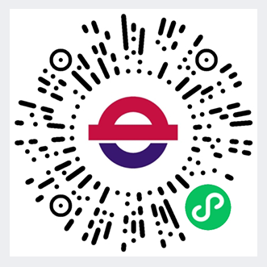

# 镜越山海 · 翠湖跑步 Agent v1.9.0

**马拉松 → 昆明市跑步路线（翠湖）→ 个人补给方案 → 三种选项。** 跑者先在 Rokid 眼镜上选定路线，再决定这次跑步要不要补给提醒、用哪份方案。选择迈胜「胜算」时，跑者在手机生成自己的比赛方案，由眼镜读取。开跑后，跑到方案指定的里程，眼镜会显示并读出当前应补充的产品和数量。

[下载 AIX 安装包](./翠湖-个人补给方案-v1.9.0.aix?raw=true) · [下载完整源码](./cuihu-agent-source-v1.9.0.zip?raw=true) · [打开迈胜胜算微信太阳码](./迈胜胜算-微信太阳码.png)

## 赛前入口与三种选项

在「马拉松」列表中选中 **「昆明市跑步路线（翠湖）」**，眼镜随即打开 **「个人补给方案」** 页。以下三个选项并列显示，镜腿滑动切换，单击选择其中一项。

| 眼镜上的选项 | 选择后会发生什么 | 怎样开跑 |
| --- | --- | --- |
| **大模型生成常规补给建议** | 眼镜调用运行端配置的大模型，为本次 5 公里跑生成 1 至 3 个常规提示点，例如按需饮水、检查随身饮水。跑者可逐点查看或重新生成。 | 点「采用常规建议」，再点「使用当前方案开跑」。 |
| **无需补给提醒** | 本次关闭补给卡片和补给语音，继续使用翠湖路线导航、配速，以及已连接设备提供的心率。 | 点「开始跑步」。 |
| **微信迈胜 · 胜算专属方案** | 眼镜引导跑者在手机微信打开迈胜「胜算」小程序。小程序根据跑者自己填写的信息生成方案，眼镜拍照读取其中的赛中条目。 | 核对里程、产品、数量和本次绑定码，依次点「确认绑定」和「使用当前方案开跑」。 |

## 用微信胜算绑定自己的方案

| 顺序 | 在哪里操作 | 跑者做什么，完成后看到什么 |
| --- | --- | --- |
| 1 | 眼镜 | 选「微信迈胜 · 胜算专属方案」，进入微信引导页。此时可以拿出手机。 |
| 2 | 手机微信 | 在微信里搜索「胜算」，或长按识别本页的静态太阳码。进入迈胜小程序，填写个人信息，生成本次比赛的个人专属补给方案。 |
| 3 | 手机 → 眼镜相机 | 在手机上打开本人方案的 **「赛中」正文**，使里程、产品名称、数量同时可见。在眼镜点 **「拍照识别赛中方案」**，对准这些文字拍摄。长图可选「长图分屏拍摄」，从第一段拍到最后一段，最多 4 张，相邻照片保留相同的段落标题，再点「完成拍照并识别」。 |
| 4 | 眼镜 | 读出有效赛中条目后，眼镜为这份方案 **随机生成六位绑定码**，进入「核对赛中方案」。对照手机原文，用「查看下一个点」核对每个点的累计里程、产品、数量与单位。同点有多项时，用「下一段原文」逐项查看。有误可点「修正识别结果」或「重新拍照」。 |
| 5 | 眼镜 | 点 **「确认绑定」**，看到「个人方案已绑定」、本次六位码以及已匹配的路线提醒点数量。此时可以核对自己准备开跑的方案。 |
| 6 | 眼镜 | 点 **「使用当前方案开跑」**，启动本次跑步和翠湖路线导航。此后按已确认方案的累计里程触发近眼显示与语音提示。 |

**胜算微信小程序入口（静态太阳码）**

在手机微信中长按识别下图。拍照时，把手机切到带有里程和产品文字的个人方案页。六位绑定码会出现在眼镜的核对页。

## 翠湖 5 公里如何按距离提醒

眼镜按翠湖 GPX 轨迹从起点起算的**累计里程**匹配补给点。方案写「起点至第 1 点 200 米、第 1 点至第 2 点 300 米」时，眼镜分别在 **200 米、500 米** 提醒。方案已经写明累计里程时，直接使用该里程。同一里程有两种产品，就合并为一次到点提醒。

下表取自一份 5 公里方案的轨迹回放，展示分段距离怎样落到路线，以及跑者到点会看到什么。实际跑步使用各自确认的产品和数量。

| 方案中的本段距离 | 从起点累计 | 到点卡片的补给内容 |
| --- | --- | --- |
| 200 米 | 0.2 公里 | 迈胜清酸片 PRO 1片 |
| 300 米 | 0.5 公里 | 按方案补水 |
| 500 米 | 1 公里 | 迈胜续航机能胶 PRO 1袋 |
| 1 公里 | 2 公里 | 迈胜液体盐丸 1袋 |
| 1 公里 | 3 公里 | 迈胜电解质浓缩液 PRO 1袋，兑水分次饮用 |
| 2 公里 | 5 公里 | 迈胜续航机能胶 PRO 1袋、迈胜液体盐丸 1袋 |

在上表示例的 **5 公里** 处，眼镜近眼卡片显示「5 公里 · 到点」，两行分别列出机能胶和液体盐丸。同时发起一次语音播报，读出已到 5 公里、两种产品的全名以及各 1 袋。跑者可进入「补给详情」选择「已补给」或「跳过本点」，赛后只统计本人确认的补给次数。

定位有效并匹配到路线时才触发提醒。暂停、偏航或定位不确定时暂缓播报，恢复后跳过已经远离的点位，避免在错误的位置提示补给。

## 验证情况

v1.9.0 AIX 已通过静态检查。用上述示例回放翠湖轨迹，六个点各触发一次，5 公里处的两种产品及数量均进入了显示卡片和播报内容。回放使用模拟相机、模型和语音接口。真机拍照需要相机权限和支持图片输入的模型，手机屏幕上的文字识别效果与眼镜实际出声仍待实机验证。
